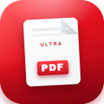
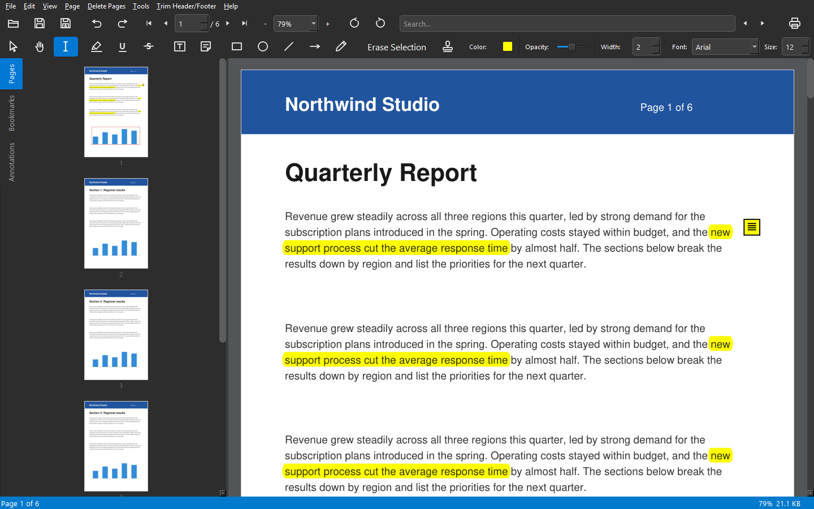

<div align="center">



# Ultra PDF Editor

**A free, offline desktop PDF editor. Edit text, annotate, merge, split, OCR and protect PDFs without uploading them anywhere.**

[](https://github.com/uniqueabhishek/PDF-editor-full-featured/actions/workflows/ci.yml)
[](LICENSE)
[](https://www.python.org/downloads/)
[](https://www.riverbankcomputing.com/software/pyqt/)
[](https://github.com/astral-sh/ruff)
[](https://github.com/astral-sh/uv)

[Features](#features) · [Install](#install) · [Usage](#usage) · [Shortcuts](#keyboard-shortcuts) · [User Guide](docs/USER_GUIDE.md) · [Contributing](CONTRIBUTING.md)



</div>

## Why Ultra PDF Editor?

- **Private.** Everything runs on your computer. No account, no upload, no telemetry.
- **Free and open source.** MIT licensed, with no watermarks and no paid tier.
- **Edits the text itself.** Double-click a paragraph and retype it, or find and replace across the whole file.
- **Fast on large files.** Pages render in a separate process and only when they scroll into view, so even long PDFs open and scroll quickly.
- **Every change can be undone** until you save, including OCR, crop, watermark and redaction.

## Features

| Area | What you can do |
|---|---|
| **View** | Single page, two pages or continuous scroll · zoom and fit · full screen · thumbnails, bookmarks and annotations panels · dark and light themes |
| **Edit text** | Edit a text block in place · find and replace · erase a selected area |
| **Annotate** | Highlight, underline, strikethrough · sticky notes and text boxes · rectangles, circles, lines, arrows · freehand drawing · stamps · colour, opacity and width controls |
| **Pages** | Insert blank pages or pages from another file · delete, rotate, crop, extract · reorder by dragging thumbnails |
| **Merge and split** | Merge several PDFs (with a bookmark per file) · split by page count, page ranges or bookmarks |
| **Clean up** | Detect and trim repeated headers and footers · add a watermark · add headers and footers with page numbers |
| **Optimise** | Compress and optimise to shrink file size |
| **OCR** | Add a searchable text layer to scanned pages with Tesseract |
| **Security** | Password-protect with AES-256 · remove a password · redact content permanently |
| **Export** | Pages as PNG images · text to Word (`.docx`) or plain text · print |
| **Batch** | Run the same operation over a folder of PDFs |

## Install

Ultra PDF Editor runs from source with [uv](https://docs.astral.sh/uv/), which installs the exact library versions the app was tested with.

**1. Install the tools** (once per computer)

- [Python 3.10 or newer](https://www.python.org/downloads/) (3.13 recommended)
- [uv](https://docs.astral.sh/uv/getting-started/installation/)
- [Git](https://git-scm.com/downloads)

**2. Get the app and start it**

```bash
git clone https://github.com/uniqueabhishek/PDF-editor-full-featured.git
cd PDF-editor-full-featured
uv sync
uv run ultra-pdf-editor
```

To open a file straight away: `uv run ultra-pdf-editor "path/to/file.pdf"`.

**3. Optional: OCR**

OCR needs the free [Tesseract](https://github.com/tesseract-ocr/tesseract) engine. The app finds it on your `PATH` or in its usual install folder.

| System | Command |
|---|---|
| Windows | Download the installer from [UB Mannheim](https://github.com/UB-Mannheim/tesseract/wiki) |
| macOS | `brew install tesseract` |
| Ubuntu / Debian | `sudo apt install tesseract-ocr` |

**4. Optional: open PDFs from Explorer (Windows)**

```powershell
powershell -ExecutionPolicy Bypass -File .\register_file_association.ps1
```

This adds Ultra PDF Editor to the right-click **Open with** menu and creates a Desktop shortcut, without administrator rights. Run it again with `-Unregister` to remove it.

> Developed and tested on Windows 10 and 11. PyQt6 and PyMuPDF also run on macOS and Linux, but those platforms are not tested yet; reports are welcome.

## Usage

- **Open** a file with `Ctrl+O`, by dragging it onto the window, or from **File → Recent Files**.
- **Edit text:** with the Text tool (`I` icon), double-click a paragraph, retype it, then press `Ctrl+Enter` or click away. `Esc` cancels.
- **Annotate:** pick a tool on the second toolbar, set colour and width, then drag on the page.
- **Reorder pages:** drag thumbnails in the **Pages** panel; right-click one for rotate, extract or delete.
- **Merge, split, OCR, watermark, encrypt:** all live in the **Tools** menu.
- **Save** with `Ctrl+S`. Until then, every change can be undone with `Ctrl+Z`.

The [User Guide](docs/USER_GUIDE.md) walks through every tool.

## Keyboard shortcuts

| Action | Shortcut | Action | Shortcut |
|---|---|---|---|
| Open | `Ctrl+O` | Find | `Ctrl+F` |
| Save | `Ctrl+S` | Find and replace | `Ctrl+H` |
| Save as | `Ctrl+Shift+S` | Zoom in / out | `Ctrl++` / `Ctrl+-` |
| Print | `Ctrl+P` | Fit width / fit page | `Ctrl+1` / `Ctrl+2` |
| Undo / redo | `Ctrl+Z` / `Ctrl+Y` | Actual size | `Ctrl+0` |
| Rotate page | `Ctrl+R` / `Ctrl+Shift+R` | Full screen | `F11` |
| Preferences | `Ctrl+,` | Next / previous page | `Page Down` / `Page Up` |

**Help → Keyboard Shortcuts** in the app lists them all.

## Configuration

Settings are saved in `~/.ultra_pdf_editor/settings.json` (on Windows, `C:\Users\<you>\.ultra_pdf_editor\`), next to the log file `ultra_pdf.log`. Most of them are set from **Edit → Preferences**.

A few advanced options are read from environment variables; copy `.env.example` to `.env` to change them.

| Variable | Default | Purpose |
|---|---|---|
| `TESSERACT_CMD` | (found automatically) | Full path to `tesseract.exe` |
| `OCR_LANGUAGE` | `eng` | Tesseract language code, e.g. `eng+deu` |
| `RENDER_DPI` | `150` | Screen render quality; lower it on slow machines |
| `HIGH_QUALITY_DPI` | `300` | Export and print quality |

## Troubleshooting

- **The app does not start:** run `uv sync` again, then `uv run ultra-pdf-editor` in a terminal and read the error it prints.
- **OCR says Tesseract was not found:** check `tesseract --version` works, or set `TESSERACT_CMD` in `.env`.
- **A PDF will not open:** it may be damaged (try another viewer) or need a password, which the app asks for.
- **Scrolling feels slow on a huge file:** lower `RENDER_DPI` to `120` or `100`.
- **Something else:** the log at `~/.ultra_pdf_editor/ultra_pdf.log` usually says why. Please attach it to a [bug report](https://github.com/uniqueabhishek/PDF-editor-full-featured/issues/new/choose).

## Built with

| Library | Used for |
|---|---|
| [PyQt6](https://www.riverbankcomputing.com/software/pyqt/) | The desktop interface |
| [PyMuPDF](https://pymupdf.readthedocs.io/) | Rendering and editing PDFs |
| [Pillow](https://python-pillow.org/) | Image handling for OCR and export |
| [pytesseract](https://github.com/madmaze/pytesseract) | Talking to the Tesseract OCR engine |
| [python-docx](https://python-docx.readthedocs.io/) | Word export |
| [darkdetect](https://github.com/albertosottile/darkdetect) | Following the system light or dark theme |

## Contributing

Bug reports, ideas and pull requests are welcome.

- **Found a bug?** [Open an issue](https://github.com/uniqueabhishek/PDF-editor-full-featured/issues/new/choose) with the steps and the log file.
- **Want a feature?** Open a feature request and describe what you are trying to do.
- **Want to write code?** Read [CONTRIBUTING.md](CONTRIBUTING.md). In short:

```bash
uv sync
uv run pre-commit install --hook-type pre-commit --hook-type pre-push
uv run pytest -p no:faulthandler
```

Ruff and mypy run on every commit and the test suite on every push. The [architecture notes](docs/ARCHITECTURE.md) explain how the code is laid out.

## License

[MIT](LICENSE). Free to use, change and share, including commercially.

Note that PyMuPDF is licensed under the [GNU AGPL](https://pymupdf.readthedocs.io/en/latest/about.html#license-and-copyright) and PyQt6 under the [GPL](https://www.riverbankcomputing.com/static/Docs/PyQt6/introduction.html#license), so a program you distribute that bundles them must follow those licenses too.

---

<div align="center">

If Ultra PDF Editor saves you time, please **star the repository** so more people can find it.

</div>
